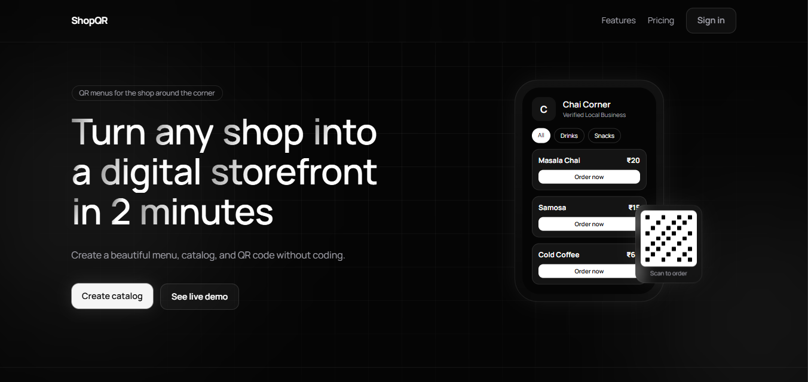
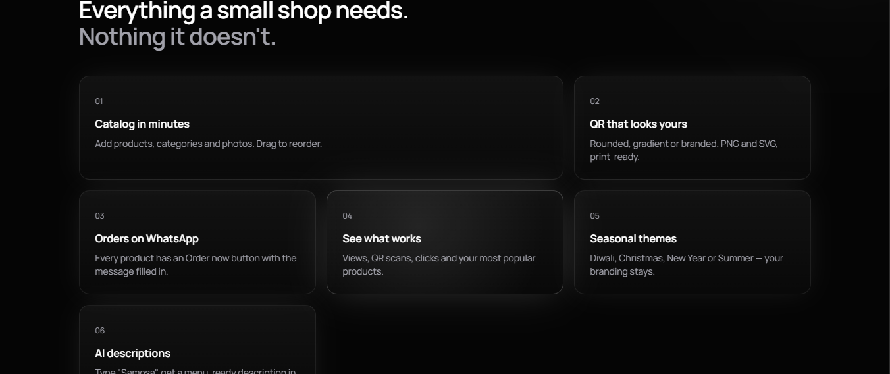
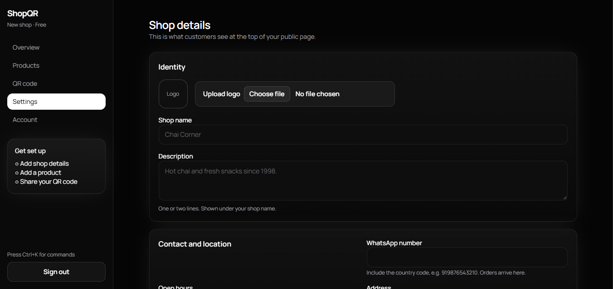
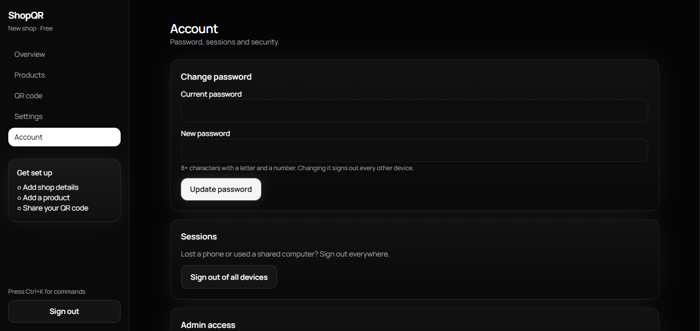

<div align="center">

# ShopQR

**Turn any shop into a digital storefront in 2 minutes.**

QR menu & catalog SaaS for the shop around the corner — create a menu, share a QR code, and receive orders on WhatsApp.

[](https://shopqr-nine.vercel.app/)


**🔗 Live: [https://shopqr-nine.vercel.app/](https://shopqr-nine.vercel.app/)**

</div>

---

## Table of Contents

- [Screenshots](#screenshots)
- [Features](#features)
- [Tech Stack](#tech-stack)
- [Getting Started](#getting-started)
- [Deployment](#deployment)
- [Plans](#plans)
- [Project Structure](#project-structure)
- [Security Model](#security-model)
- [Roadmap](#roadmap)

---

## Screenshots

### Landing page


### Features


### Dashboard — Shop details


### Dashboard — Account & security


---

## Features

| | Feature | Description |
|---|---|---|
| 01 | **Catalog in minutes** | Add products, categories and photos. Drag to reorder. |
| 02 | **QR that looks yours** | Rounded, gradient or branded QR codes. PNG and SVG, print-ready. |
| 03 | **Orders on WhatsApp** | Every product has an *Order now* button with the message pre-filled. |
| 04 | **See what works** | Views, QR scans, clicks and your most popular products. |
| 05 | **Seasonal themes** | Diwali, Christmas, New Year or Summer — your branding stays. |
| 06 | **AI descriptions** | Type a product name (e.g. "Samosa") and get a menu-ready description, powered by Gemini. |

---

## Tech Stack

| Layer | Technology |
|---|---|
| Frontend | Next.js 15 (App Router, SEO metadata) |
| Backend | Express.js |
| Database | MongoDB (Atlas) |
| AI | Google Gemini (template fallback if no key) |
| Media | Cloudinary |
| Hosting | Vercel (web) · Render (API) |
| DevOps | Docker Compose · GitHub Actions CI |

---

## Getting Started

**Prerequisites:** Node.js 22+ and a MongoDB instance (local via Docker, or Atlas).

```bash
# 1. Install all dependencies
npm run install:all

# 2. Configure environment
#    - Server values from .env.example  ->  server/.env
#    - Client value                      ->  client/.env.local

# 3. Start the API and the web app (in separate terminals)
npm run dev:server
npm run dev:client
```

Open **http://localhost:3000**.

- A demo shop is seeded at `/shop/demo`.
- To become an admin, enter `ADMIN_CODE` under **Account → Admin access**.

### Run with Docker

```bash
docker compose up
```

Starts the local API and MongoDB.

---

## Deployment

Follow these steps **in order**.

1. **MongoDB Atlas** — Create a free cluster, add a database user, and under *Network Access* allow `0.0.0.0/0` (Render has no fixed IP). Copy the `mongodb+srv://` connection string.
2. **Render (API)** — New Blueprint from this repo (`render.yaml` included). Set `MONGO_URI`, `GEMINI_API_KEY`, `CLOUDINARY_URL` and `ADMIN_CODE`. Leave `CLIENT_ORIGIN` empty for now. Open `<api-url>/api/health` — it must return `{"ok":true}`.
3. **Vercel (web)** — Import the repo, set Root Directory to `client`, and set `NEXT_PUBLIC_API=<api-url>` (no trailing slash). Deploy.
4. **Back on Render** — Set `CLIENT_ORIGIN=<vercel-url>` and redeploy.
5. **Verify** — Run `node server/smoke.mjs <api-url>`; every line should show ✓. Then register in the browser and create a shop.

> **Tip:** Use Cloudinary in production. Without it, images are stored inside MongoDB.

### Environment variables

| Variable | Where | Purpose |
|---|---|---|
| `MONGO_URI` | Server | MongoDB connection string |
| `GEMINI_API_KEY` | Server | AI descriptions (from Google AI Studio) |
| `CLOUDINARY_URL` | Server | Image uploads |
| `ADMIN_CODE` | Server | Grants admin access from the dashboard |
| `CLIENT_ORIGIN` | Server | Allowed web origin for CORS |
| `NEXT_PUBLIC_API` | Client | Base URL of the API |

---

## Plans

| Plan | Products |
|---|---|
| **Free** | Up to 12 |
| **Pro** | Unlimited |

Admins can switch plans via:

```http
PATCH /api/admin/shop/:slug
Content-Type: application/json

{ "plan": "pro" }
```

---

## Project Structure

```text
.
├── server/
│   ├── src/index.js          # Express API: auth, shop CRUD, uploads, Gemini, public + analytics routes
│   └── smoke.mjs             # Post-deploy smoke test
├── client/
│   ├── app/                  # Routes: landing, /dashboard, /shop/[slug] (SEO metadata)
│   ├── components/dashboard/ # One component per dashboard section; shared UI in shared.tsx
│   └── lib/                  # API client, QR generator
├── docker-compose.yml        # Local API + MongoDB
├── render.yaml               # Render Blueprint
└── .github/workflows/ci.yml  # Build check
```

---

## Security Model

- **Passwords** — bcrypt (cost 12); 8–72 characters with at least one letter and one number. Accounts lock for 15 minutes after 5 wrong attempts; login and register are rate-limited.
- **Sessions** — 7-day signed JWTs verified against the database on every request. Changing your password or using **Sign out of all devices** instantly invalidates every existing token.
- **Authorization** — Every shop read/write is scoped to the signed-in owner's id. Admin rights are checked in the database, not the token, and the admin code is compared in constant time.
- **Input hardening** — String-only fields (blocks NoSQL operator injection), validated product ids, strict CORS, security headers (Helmet + Next headers), and a 6 MB body cap.

---

## Roadmap

- [ ] Payments (Razorpay / Stripe) — the one piece left before charging for Pro
- [ ] Email verification
- [ ] "Forgot password" flow

> Email features need an email provider such as Resend or Brevo.

---

<div align="center">

**[🌐 View Live Site](https://shopqr-nine.vercel.app/)**

</div>
[text](../../Downloads/shopqr-readme/shopqr-readme/docs)